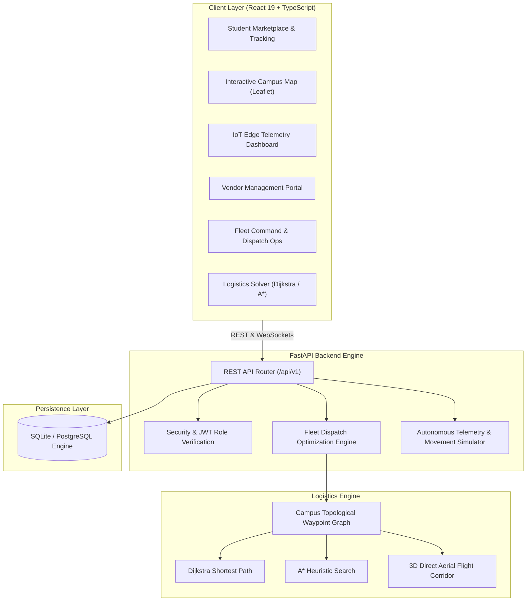
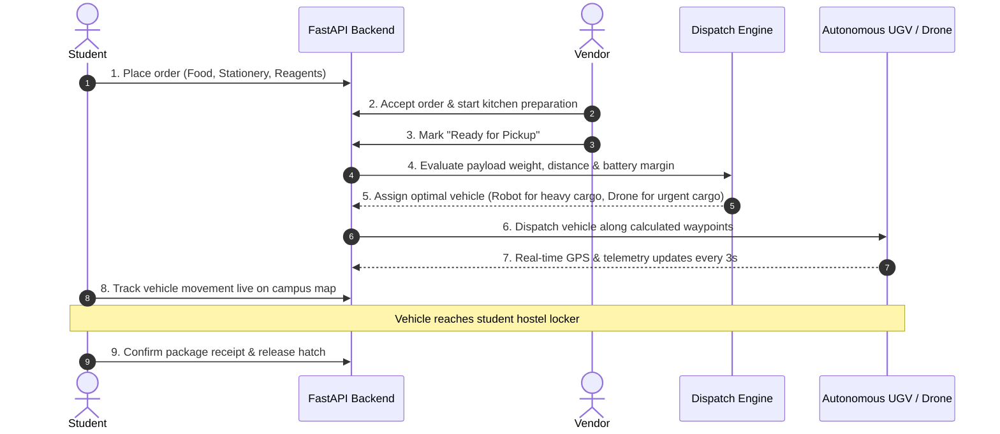

# CAMPUSNEX — Smart Campus Delivery Ecosystem
> **"Your Campus. Your Delivery. Your Time."**  
> *An Academic Full-Stack Micro-Project in Smart Mobility & Autonomous Logistics (Integrating CO1, CO3, and CO4).*

---

## 1. Project Overview

**CAMPUSNEX** is a next-generation smart campus delivery platform designed to eliminate courier vehicular congestion, reduce carbon footprints, and expedite intra-campus logistics across university grounds. The platform orchestrates an autonomous fleet comprising **autonomous ground robots (UGVs)** and **autonomous aerial drones (UAVs)** to deliver meals, drafting tools, curriculum textbooks, and hazardous biotechnology lab supplies.

The project demonstrates how **IoT edge sensing (CO1)**, **shortest-path logistics optimization (CO3)**, and **sustainable green transportation (CO4)** integrate into a production-grade Software-as-a-Service (SaaS) architecture.

---

## 2. Problem Statement & Proposed Solution

### The Campus Logistics Challenge
- **Traffic Congestion & Safety Risks**: Conventional third-party food and supply couriers utilize combustion motorbikes, causing pedestrian safety hazards on university walkways.
- **High Carbon Emissions**: Short-distance courier hops generate disproportionate greenhouse gases and carbon particulates.
- **Delivery Inefficiencies**: External couriers face gate checkpoint delays, dorm access restrictions, and lack of real-time intra-campus localization.

### The CAMPUSNEX Solution
- **Zero-Emission Autonomous Fleet**: 100% electric Ground Delivery Robots (UGVs) and Octocopter Drones (UAVs).
- **Algorithmic Fleet Dispatch**: Dijkstra & A* routing with payload weight and battery feasibility constraints.
- **End-to-End Coordinated SaaS**: Seamlessly links Students, Campus Vendors, Fleet Dispatchers, and Autonomous Vehicles.
- **Simulated Real-Time IoT Telemetry**: Continuous sensor streams for battery degradation, vibration, RTK GPS coordinates, and motor temperature.

---

## 3. Technology Stack

### Frontend
- **Framework**: React 19 + Vite + TypeScript
- **Styling**: Tailwind CSS (Custom Dark Futuristic Theme `#101820`, `#17232B`, `#B9F66B`)
- **Icons**: Lucide React
- **Geospatial Mapping**: Leaflet with OpenStreetMap & CartoDB Dark Matter tiles
- **Data Visualization**: Recharts (Carbon abatement, fleet modal share, emission comparisons)
- **Routing**: React Router v7

### Backend
- **Architecture**: Python FastAPI REST API Gateway
- **ORM & Database**: SQLAlchemy 2.0 with SQLite (production-ready for PostgreSQL)
- **Validation**: Pydantic v2 schemas
- **Security**: Salted PBKDF2-HMAC-SHA256 password hashing + JWT OAuth2 tokens
- **Pathfinding & AI**: Dijkstra's Algorithm, A* Heuristic Search, and 3D Aerial Corridor interpolations
- **IoT & Background Simulation**: Asyncio background telemetry engine simulating MQTT packets

---

## 4. System Architecture



---

## 5. Course Outcome (CO) Alignment

| Course Outcome | Academic Competency | Practical Implementation in CAMPUSNEX |
| :--- | :--- | :--- |
| **CO1** | **Smart Mobility Architecture & IoT Edge Telemetry** | Simulated edge sensor telemetry (`temp_c`, `battery_percentage`, `vibration_g`, `rssi_dbm`, `gps_satellites_locked`) with simulated MQTT message frames. |
| **CO3** | **Logistics Optimization & Pathfinding** | Graph-based campus waypoint solver comparing Dijkstra's Single-Source Shortest Path vs A* Heuristic search and Drone Corridors. Multi-constraint vehicle matching. |
| **CO4** | **Green Transportation & Environmental Analytics** | Real-time mathematical carbon abatement model calculating avoided CO2 (kg) and displaced petrol (L) against standard 125cc combustion motorbikes. |

---

## 6. Delivery Lifecycle Flowchart



---

## 7. Preconfigured Demo Accounts

Evaluators and faculty can log in instantly using the clearly labelled **1-Click Demo Buttons** on the login screen, or with these credentials:

| Role | Account Name | Email | Password | Primary Dashboard |
| :--- | :--- | :--- | :--- | :--- |
| **Student** | Alex Chen | `student@campusnex.edu` | `password123` | `/student` (Order, cart, live tracking) |
| **Vendor** | Cafeteria Express | `vendor@campusnex.edu` | `password123` | `/vendor` (Kitchen queue, inventory) |
| **Admin** | Campus Dispatch Ops | `admin@campusnex.edu` | `password123` | `/admin` (Fleet control, IoT telemetry) |

---

## 8. Installation & Execution Instructions

### Prerequisites
- Python 3.10+
- Node.js 18+ and npm

### Step 1: Clone or Navigate to the Workspace
```powershell
cd "c:\Users\HP\OneDrive\Desktop\VENTURE MICRO PROJECT\campusnex"
```

### Step 2: Backend Setup & Execution
```powershell
# Navigate to backend
cd backend

# Create virtual environment (optional)
python -m venv venv
venv\Scripts\activate

# Install dependencies
pip install -r requirements.txt

# Start FastAPI server (seeds initial demo database automatically)
uvicorn app.main:app --host 127.0.0.1 --port 8000 --reload
```
*Backend API will run at: `http://127.0.0.1:8000` (Swagger docs at: `http://127.0.0.1:8000/docs`)*

### Step 3: Frontend Setup & Execution
Open a second terminal:
```powershell
# Navigate to frontend
cd "c:\Users\HP\OneDrive\Desktop\VENTURE MICRO PROJECT\campusnex\frontend"

# Install npm dependencies (already configured)
npm install

# Start Vite Development Server
npm run dev
```
*Frontend application will run at: `http://localhost:5173`*

---

## 9. Running Verification Tests

Run the backend unit test suite:
```powershell
cd "c:\Users\HP\OneDrive\Desktop\VENTURE MICRO PROJECT"
python -u -m pytest campusnex/backend/tests -v
```
*All 9 test suites verify password hashing, JWT security, product queries, Dijkstra/A* routing, dispatch optimization, IoT telemetry, and sustainability algorithms.*

To test building the frontend:
```powershell
npm --prefix campusnex/frontend run build
```

---

## 10. Future Physical Hardware Extensions

1. **MQTT Broker Integration**: Direct connection to Mosquitto or HiveMQ edge brokers (`ws://broker.hivemq.com:8000/mqtt`).
2. **Pixhawk / ArduPilot MavLink**: Real-world telemetry uplink with physical quadcopter drones.
3. **Computer Vision Obstacle Avoidance**: ROS2 (Robot Operating System) node running YOLOv8 object detection on Jetson Nano edge kits for pedestrian avoidance.
4. **Automated QR-Code Cargo Locker**: NFC or QR-code based parcel bay unlocking mechanism at student hostels.

