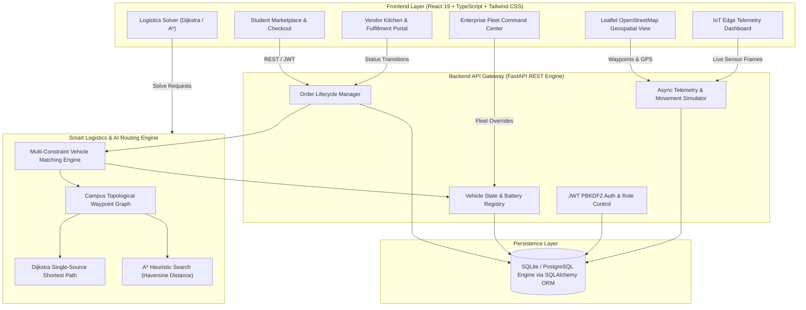

# CAMPUSNEX — System Architecture & Course Outcome Integration

## 1. Executive Architecture Overview

CAMPUSNEX is an autonomous smart mobility and logistics coordination platform designed for university campuses. It connects student consumers, campus retail vendors, autonomous ground delivery robots (UGVs), and high-speed aerial octocopter drones (UAVs) under a unified algorithmic dispatch engine.

---

## 2. Academic Course Outcomes (CO) Integration

### CO1: Smart Mobility Architecture & IoT Edge Telemetry
- **Hardware Abstraction**: Designed for edge integration with ESP32 microcontrollers, Pixhawk autopilots, and LiDAR rangefinders.
- **Simulated MQTT Protocol**: Generates continuous simulated IoT telemetry streams (`core_temp_c`, `battery_percentage`, `vibration_g`, `network_latency_ms`, `heading_deg`, and `gps_satellites_locked`).
- **Telemetry Persistence**: Every vehicle step is logged into `tracking_history` with timestamped sensor metrics.

### CO3: Logistics Route Optimization & Algorithmic Dispatch
- **Topological Campus Graph**: 11 key campus waypoint nodes connected via weighted bidirectional walking paths and 3D direct aerial flight corridors.
- **Dijkstra's Algorithm**: Calculates optimal ground path without heuristic bias ($O(V \log V + E)$).
- **A\* Heuristic Search**: Accelerates search state traversal using admissible Haversine Euclidean distance $h(n) \le d^*(n, \text{goal})$.
- **Fleet Dispatch Optimization**: Multi-constraint vehicle matching:
  $$\text{Score} = \text{ETA} \times w_{\text{priority}} \quad \text{subject to} \quad \text{Payload} \le C_{\text{max}}, \ \text{Battery} \ge B_{\text{trip}} + 15\%$$

### CO4: Green Transportation & Environmental Sustainability
- **Zero Direct Tailpipe Emissions**: Displaces conventional 125cc combustion motorcycles with solar-charged battery electric UGVs and UAVs.
- **Empirical Carbon Abatement Model**:
  $$\text{CO}_2 \text{ Avoided (kg)} = \text{Distance (km)} \times (0.1142 - 0.0184) \text{ kg/km}$$
- Displaces ~0.045 liters of fossil petrol per delivery kilometer.

