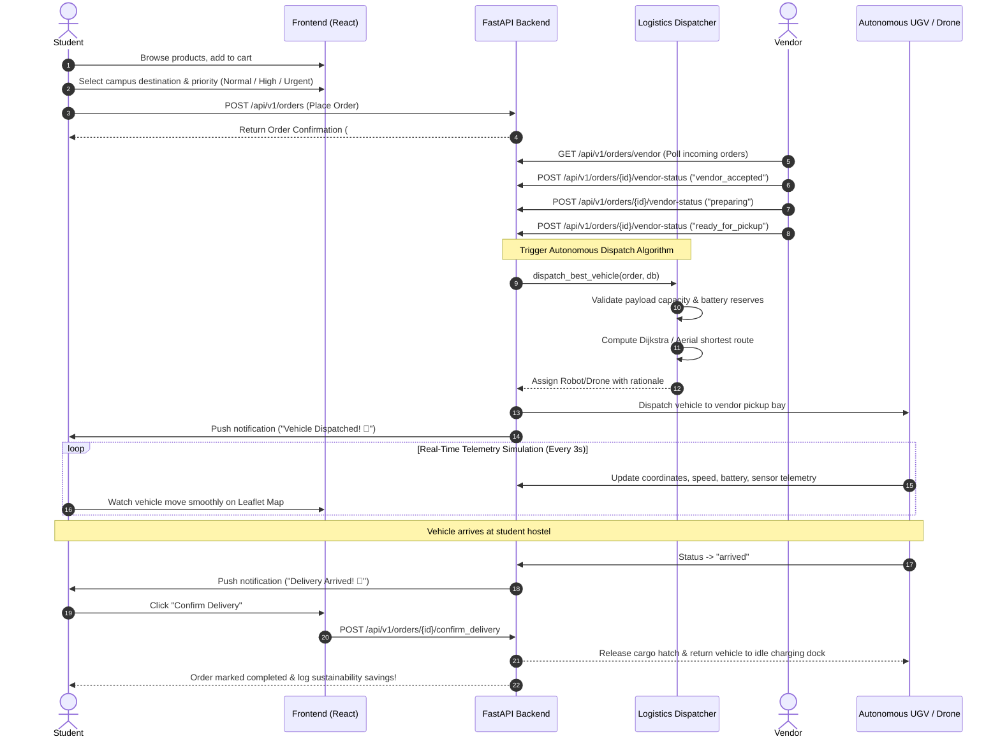

# CAMPUSNEX — End-to-End Order & Delivery Lifecycle Workflow

This document illustrates the complete lifecycle workflow from initial student ordering to vendor kitchen preparation, autonomous vehicle assignment, live GPS tracking, and final package handover.

---

## State Transition Machine

| Status | Actor Trigger | Action Taken | Next Legal States |
| :--- | :--- | :--- | :--- |
| `pending` | Student | Order submitted, stock decremented | `vendor_accepted`, `cancelled` |
| `vendor_accepted` | Vendor | Kitchen verifies items and prepares station | `preparing`, `cancelled` |
| `preparing` | Vendor | Cooking / packaging cargo | `ready_for_pickup`, `cancelled` |
| `ready_for_pickup` | Vendor | Triggers automatic fleet dispatch engine | `assigned` |
| `assigned` | Dispatch Engine | Nearest compliant robot or drone dispatched | `in_transit` |
| `in_transit` | Simulator / Vehicle | Traversing waypoints with live GPS & sensor stream | `delivered`, `failed` |
| `delivered` | Student / Auto | Cargo safely retrieved, vehicle returned to dock | Terminal State |
| `cancelled` | Student / Vendor | Restocks inventory, cancels assignment | Terminal State |

